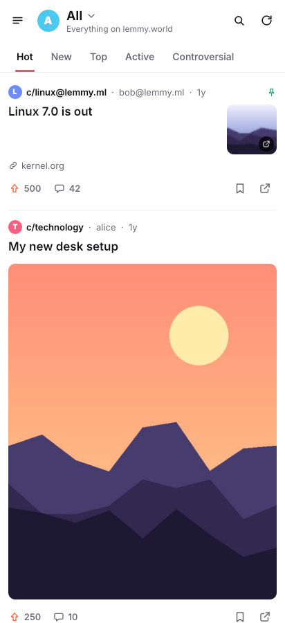
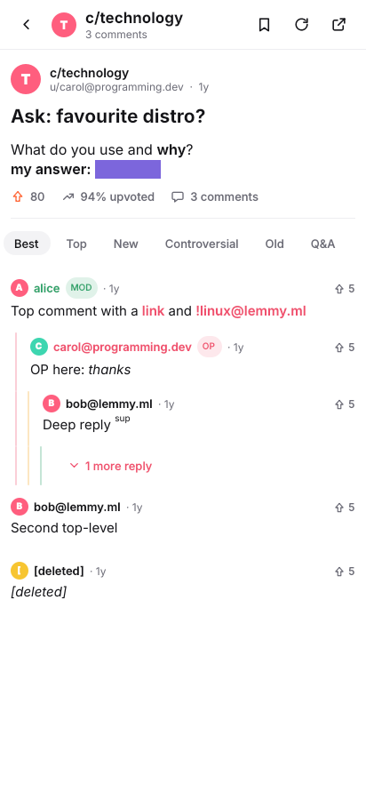
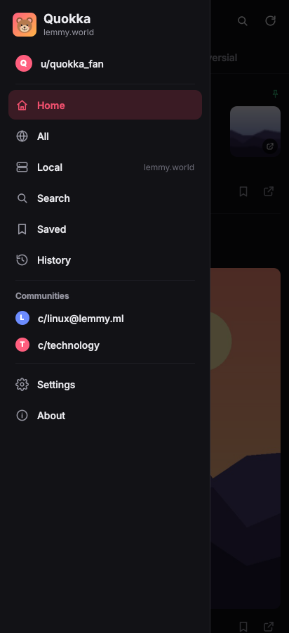
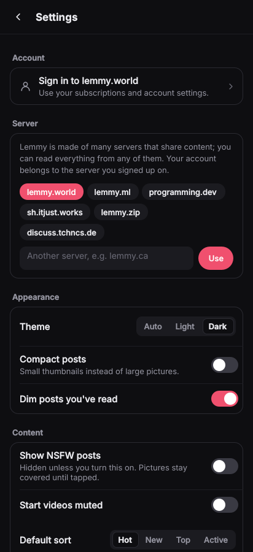
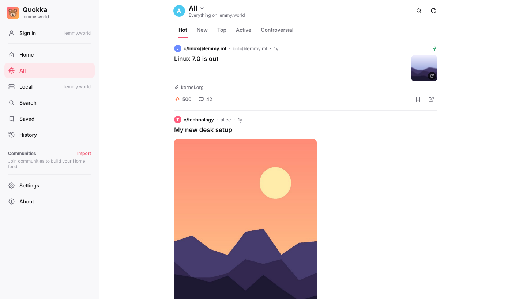

<p align="center"></p>

<h1 align="center">Quokka</h1>

<p align="center">A playful, read-only <b>Lemmy</b> client for <b>Linux</b> and <b>Android</b>, built with <b>Qt 6 / QML</b>.<br>
It reads the public API of any Lemmy server (lemmy.world by default), so no account is needed.</p>

<p align="center">
  
  
  
  
</p>
<p align="center"></p>

> Status: pre-1.0, in testing. Nothing is released until 1.0.0.
>
> **Why Lemmy?** Quokka started as a Reddit client built on Reddit's public `.json` pages. In 2026 Reddit
> began refusing anonymous requests (HTTP 403) and new API access needs Reddit's approval, so Quokka now
> reads [Lemmy](https://join-lemmy.org), an open, community-run forum network with a free public API. The
> Reddit code is kept behind the same interface (`QUOKKA_BACKEND=reddit`) in case API access becomes
> available. Quokka is not affiliated with Lemmy, any Lemmy server, or Reddit, Inc.

## Features

- **Feeds**: Home (merged from up to 25 communities you join), All, Local (your server), any community,
  including ones on other servers (`linux@lemmy.ml`); hot / new / top / active / controversial with time
  ranges; infinite scroll and pull-to-refresh
- **Any Lemmy server**: lemmy.world by default; switch in the drawer (lemmy.ml, programming.dev, ...)
- **Optional sign-in** to your Lemmy account: Home shows your subscriptions, Join follows on the server,
  and with "Show NSFW on my account" turned on, search includes NSFW too (Lemmy only does that for
  signed-in accounts). Two-factor codes are supported. Quokka keeps a session token per server in its
  settings file (`~/.config/Quokka/Quokka.conf` on Linux); your password is never stored. Signing out also
  ends the session on the server.
- **Posts and comments**: full post with media and Markdown text, threaded comments with coloured rails,
  collapse, "load more replies", OP / MOD badges, tap-to-reveal spoilers
- **Media viewer**: images with pinch / wheel / double-tap zoom, galleries with captions, videos with sound
  (HLS), GIFs, full screen
- **Discover**: search posts (everywhere or inside a community) and communities; community headers with
  icon, members and description; user profiles with karma, posts and comments
- **Your library, on your device**: join communities, save posts, reading history, import / export your list
- **Comfort**: light / dark / system theme, compact cards, dim read posts, NSFW hidden unless enabled
  (excluded by the server and filtered again in the app), in-app handling of Lemmy links
- **Desktop**: docked sidebar on wide windows, keyboard shortcuts (press <kbd>?</kbd>), tooltips, mouse back
  button, remembered window size

## Build and run on Linux

You need **Qt 6.8 or newer** (with Qt Multimedia), CMake 3.21+, Ninja and a C++17 compiler.

### 1. Install the tools

**Option A: your distribution's Qt** (if it ships Qt 6.8+: Fedora 41+, Arch, openSUSE Tumbleweed,
Ubuntu 25.04+, Debian 13+):

```bash
# Ubuntu / Debian
sudo apt install build-essential cmake ninja-build git \
  qt6-base-dev qt6-declarative-dev qt6-multimedia-dev qt6-svg-dev \
  qml6-module-qtquick-controls qml6-module-qtquick-layouts qml6-module-qtquick-templates \
  qml6-module-qtquick-window qml6-module-qtqml-workerscript qml6-module-qtmultimedia \
  libqt6sql6-sqlite qt6-qpa-plugins

# Fedora
sudo dnf install gcc-c++ cmake ninja-build git qt6-qtbase-devel qt6-qtdeclarative-devel \
  qt6-qtmultimedia-devel qt6-qtsvg-devel

# Arch
sudo pacman -S base-devel cmake ninja git qt6-base qt6-declarative qt6-multimedia qt6-svg
```

**Option B: the official Qt 6.8 LTS build** (works on any distribution, including older ones):

```bash
sudo apt install build-essential cmake ninja-build git libgl1-mesa-dev libxkbcommon-dev libxcb-cursor0   # Ubuntu/Debian
python3 -m pip install --user aqtinstall
python3 -m aqt install-qt linux desktop 6.8.3 linux_gcc_64 -m qtmultimedia -O ~/Qt
export CMAKE_PREFIX_PATH=~/Qt/6.8.3/gcc_64
```

(Or use the [Qt Online Installer](https://www.qt.io/download-qt-installer-oss) and tick
*Qt 6.8 → Desktop gcc 64-bit* and *Qt Multimedia*.)

### 2. Build, test and run

```bash
git clone https://github.com/sadikBr/Reddit-Client.git
cd Reddit-Client

cmake --preset desktop-release       # or desktop-debug while developing
cmake --build --preset desktop-release
./build/desktop-release/quokka
```

Run the unit tests (debug preset):

```bash
cmake --preset desktop-debug && cmake --build --preset desktop-debug
ctest --preset desktop-debug
```

Open a link straight away: `./build/desktop-release/quokka https://lemmy.ml/c/linux`

Optional install (adds a menu entry and icon):

```bash
sudo cmake --install build/desktop-release
```

Prefer an IDE? Open `CMakeLists.txt` in Qt Creator and pick the Qt 6.8 kit.

## Build for Android

Install the Android SDK, NDK r26b (26.1.10909125) and JDK 17 (Qt Creator → Preferences → Devices → Android
can do this for you), plus Qt 6.8 for Android (`aqt install-qt all_os android 6.8.3 android_arm64_v8a -m qtmultimedia -O ~/Qt`).
OpenSSL for Android is downloaded automatically at configure time.

```bash
export QT_ANDROID_ROOT=~/Qt/6.8.3/android_arm64_v8a
export QT_HOST_PATH=~/Qt/6.8.3/gcc_64
export ANDROID_SDK_ROOT=~/Android/Sdk
export ANDROID_NDK_ROOT=$ANDROID_SDK_ROOT/ndk/26.1.10909125
cmake --preset android-arm64
cmake --build --preset android-arm64
# APK: build/android-arm64/android-build/build/outputs/apk/
```

Every push to `main` also builds an AppImage and an APK in GitHub Actions (see the run's *Artifacts*).

## Developer switches

| Variable | Effect |
|---|---|
| `QUOKKA_FIXTURES=<dir>` | Serve recorded JSON from `<dir>` instead of the network (try `tests/fixtures/lemmy`) |
| `QUOKKA_BACKEND=reddit` | Use Reddit's public JSON instead of Lemmy (Reddit currently refuses anonymous access) |
| `QUOKKA_SCREENSHOT=<file.png>[:<ms>]` | Save a screenshot of the window after `<ms>` and quit |
| `QUOKKA_WINDOW_SIZE=<w>x<h>` | Window size for screenshots, e.g. `412x900` |

## Releasing (from 1.0.0)

Releases are published only for tags `v1.0.0` and later; `v0.x` tags just build. Bump `VERSION` in
`CMakeLists.txt`, then `git tag v1.0.0 && git push origin v1.0.0`. CI builds the AppImage and APK and
publishes a GitHub Release. To sign the APK with a stable key (so updates install over older versions), add
the repository secrets `ANDROID_KEYSTORE_BASE64`, `ANDROID_KEYSTORE_PASSWORD` and `ANDROID_KEY_ALIAS`.

## Project layout

```
src/core/     networking, rate limiting, Lemmy + Reddit backends, Markdown rendering (no UI, unit-tested)
src/app/      main(), QML-facing models, local library (SQLite), settings
qml/          UI: Main.qml, Nav.qml (routing), pages/, components/, theme/Theme.qml
resources/    logo, icons, desktop entry
android/      manifest and launcher icons
tests/        Qt Test suites and JSON fixtures
```
