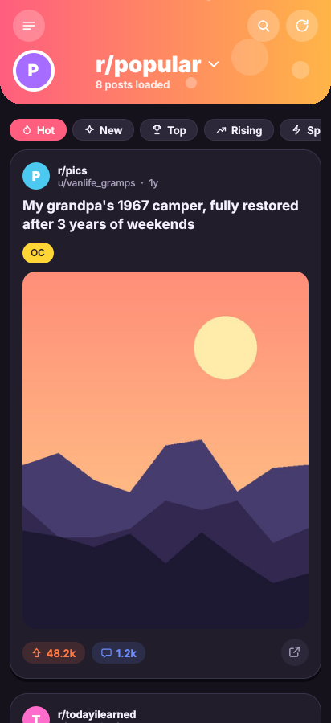
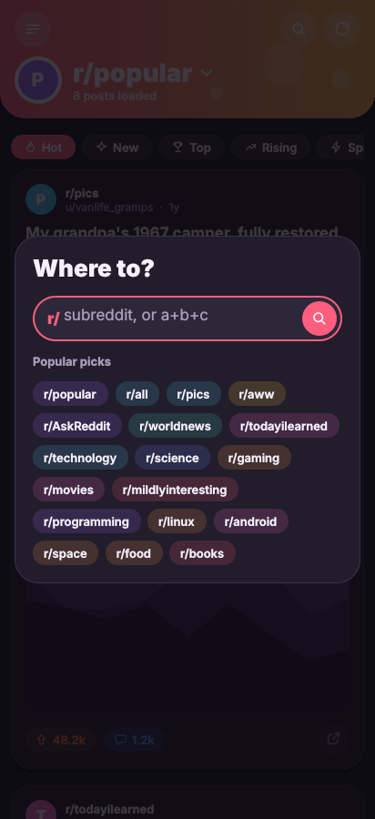

<p align="center"></p>

<h1 align="center">Quokka</h1>

<p align="center">A playful, read-only Reddit client for <b>Linux</b> and <b>Android</b>, built with <b>Qt 6 / QML</b>.<br>
It uses Reddit's public JSON endpoints (add <code>.json</code> to a Reddit URL), so no account is needed.</p>

<p align="center">
  
  
  
</p>

> Status: early development (milestone M1). See [docs/PLAN.md](docs/PLAN.md) for the roadmap.
> Quokka is not affiliated with or endorsed by Reddit, Inc.

## Features so far

- Browse `r/popular`, `r/all`, any subreddit, or a multireddit like `pics+aww`
- Sort by hot / new / top / rising / controversial, with time ranges for top
- Cards for images, galleries, videos, links and text posts; flair, spoiler and NSFW handling
- Infinite scroll, pull-to-refresh, loading skeletons, friendly error states
- Light, dark or follow-the-system theme; NSFW hidden unless enabled

## Download

Builds are attached to [GitHub Releases](https://github.com/sadikBr/Reddit-Client/releases):
`Quokka-x86_64.AppImage` (Linux) and `Quokka-arm64-v8a.apk` (Android 9+).
Every push to `main` also produces these as workflow artifacts in the Actions tab.

## Building

You need **Qt 6.8** (Qt Online Installer: Desktop gcc_64, and Android arm64-v8a for phones), CMake 3.21+ and Ninja.

### Linux

```bash
cmake --preset desktop-debug          # add -DCMAKE_PREFIX_PATH=~/Qt/6.8.3/gcc_64 if Qt is not on PATH
cmake --build --preset desktop-debug
ctest --preset desktop-debug          # unit tests
./build/desktop-debug/quokka
```

Or open `CMakeLists.txt` in Qt Creator.

### Android

Install the Android SDK, NDK r26b (26.1.10909125) and JDK 17 (Qt Creator → Preferences → Devices → Android can do
this for you). Qt's OpenSSL libraries for Android are downloaded automatically at configure time.

```bash
export QT_ANDROID_ROOT=~/Qt/6.8.3/android_arm64_v8a
export QT_HOST_PATH=~/Qt/6.8.3/gcc_64
export ANDROID_SDK_ROOT=~/Android/Sdk
export ANDROID_NDK_ROOT=$ANDROID_SDK_ROOT/ndk/26.1.10909125
cmake --preset android-arm64
cmake --build --preset android-arm64
# APK: build/android-arm64/android-build/build/outputs/apk/
```

### Developer switches

| Variable | Effect |
|---|---|
| `QUOKKA_FIXTURES=<dir>` | Serve recorded JSON from `<dir>` instead of calling Reddit (try `tests/fixtures`) |
| `QUOKKA_SCREENSHOT=<file.png>[:<ms>]` | Save a screenshot of the window after `<ms>` and quit |
| `QUOKKA_WINDOW_SIZE=<w>x<h>` | Window size for screenshots, e.g. `412x900` |

## Releasing

Bump `VERSION` in `CMakeLists.txt`, then push a tag:

```bash
git tag v0.1.0 && git push origin v0.1.0
```

CI builds the AppImage and APK and publishes a GitHub Release. To sign the APK with a stable key (so updates
install over older versions), add the repository secrets `ANDROID_KEYSTORE_BASE64`, `ANDROID_KEYSTORE_PASSWORD`
and `ANDROID_KEY_ALIAS`; without them CI signs with a throwaway key.

## Project layout

```
src/core/     networking, rate limiting, JSON parsing (no UI, unit-tested)
src/app/      main(), QML-facing models and helpers
qml/          UI: Main.qml, pages/, components/, theme/Theme.qml
resources/    logo, icons, desktop entry
android/      manifest and launcher icons
tests/        Qt Test suites and JSON fixtures
```
